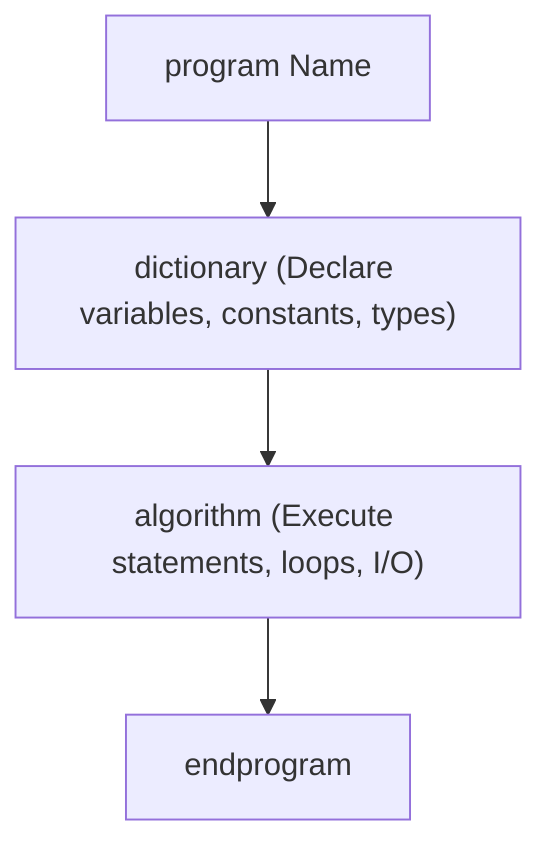

# Quickstart Tutorial

Learn how to write and run your first DAP program in 2 minutes.

---

## 1. Creating Your First File

Create a file named `hello.dap` using your preferred text editor:

```javascript
program HelloWorld
dictionary
    name : string
    age  : integer
algorithm
    write "What is your name? "
    read name

    write "How old are you? "
    read age

    print "Hello, ", name, "! You are ", age, " years old."
endprogram
```

---

## 2. Running Your Program

Execute the file using the `dap` command:

```bash
dap hello.dap
```

### Interactive Output Example
```text
What is your name? Alice
How old are you? 20
Hello, Alice! You are 20 years old.
```

---

## 3. Understanding the Anatomy

Every DAP program has three main structural components:



1. **`program <Identifier>`**: Identifies the program name.
2. **`dictionary`**: The declarative section where all variables, types, and constants must be defined.
3. **`algorithm`**: The procedural section where your logic runs step-by-step.
4. **`endprogram`**: Delimits the end of the program.

---

## 4. Trying Console (REPL) Mode

You can also run DAP in interactive mode by running `dap` without arguments:

```bash
dap
```

This starts the DAP REPL (Read-Eval-Print Loop) where you can quickly test expressions, statements, and logic.

---

## Next Steps

Now that you have run your first program, head over to the [Program Structure Reference](../language/structure.md) to explore DAP syntax and features in detail.
