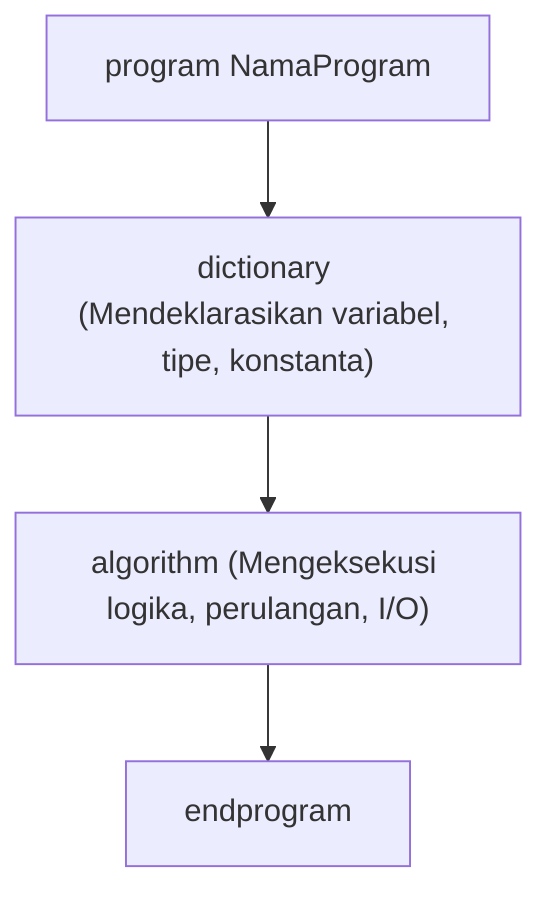

# Panduan Memulai Cepat

Pelajari cara menulis dan mengeksekusi program DAP pertama Anda dalam 2 menit.

---

## 1. Membuat Berkas Program Pertama

Buat berkas baru bernama `halo.dap` menggunakan text editor favorit Anda:

```javascript
program HaloDunia
dictionary
    nama : string
    umur : integer
algorithm
    write "Siapa nama Anda? "
    read nama

    write "Berapa umur Anda? "
    read umur

    print "Halo, ", nama, "! Umur Anda adalah ", umur, " tahun."
endprogram
```

---

## 2. Menjalankan Program

Jalankan berkas tersebut menggunakan perintah `dap`:

```bash
dap halo.dap
```

### Contoh Hasil Interaksi
```text
Siapa nama Anda? Budi
Berapa umur Anda? 20
Halo, Budi! Umur Anda adalah 20 tahun.
```

---

## 3. Memahami Struktur Utama

Setiap program DAP tersusun atas tiga komponen penting:



1. **`program <NamaProgram>`**: Mendefinisikan nama program.
2. **`dictionary`**: Bagian deklarasi tempat semua variabel, tipe, dan konstanta wajib didaftarkan sebelum digunakan.
3. **`algorithm`**: Bagian prosedural tempat instruksi logika dieksekusi langkah demi langkah.
4. **`endprogram`**: Penutup blok program.

---

## 4. Menggunakan Mode Konsol (REPL)

Anda juga dapat menjalankan DAP dalam mode interaktif dengan mengetikkan perintah `dap` tanpa argumen:

```bash
dap
```

Mode ini memudahkan Anda untuk menguji ekspresi matematika atau potongan kode secara langsung.

---

## Langkah Selanjutnya

Setelah berhasil menjalankan program pertama Anda, lanjutkan ke [Panduan Struktur Program](../language/structure.md) untuk mempelajari sintaksis dan fitur lengkap DAP.
